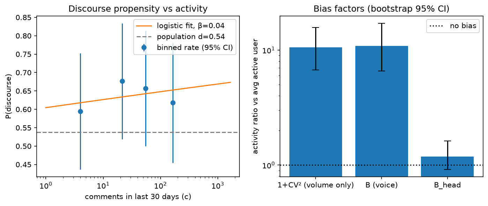
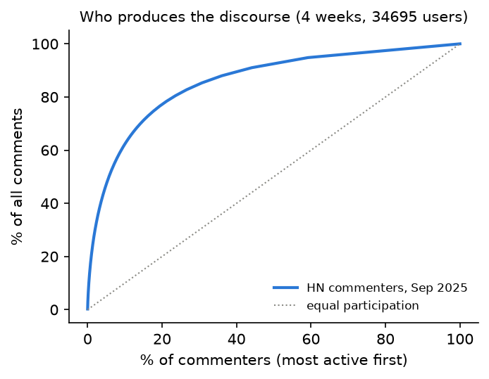
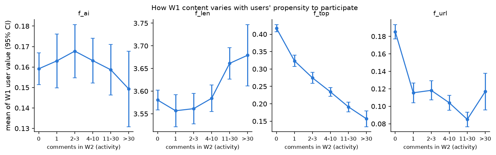

# Participation Bias in Online Discourse

> In public discourse (like on X), people who participate tend to be the kind of people who participate in discourse. **Can we model and measure that bias?**

A 2-hour research work test, run with three AI collaborators: a **primary** Claude session pair-programming with the human, an **autonomous** Claude session exploring its own direction, and **GPT (Codex)** acting as an independent reviewer. Data: public Hacker News comments via the official Algolia / Firebase APIs.

📄 **Writeup:** [`writeup.md`](writeup.md) · 📊 **Primary results:** [`primary/RESULTS.md`](primary/RESULTS.md) · 🤖 **Autonomous session report:** [`auto/REPORT.md`](auto/REPORT.md)

> For a brief note on what Agastya did chronologically, please look at the [`writeup.md`](writeup.md).

---

## Primary experiment (human + Claude)

### Definitions
| Term | Definition |
|---|---|
| **Active user** | Posted ≥ 1 HN comment in the last 30 days. Activity `c` = their 30-day comment count. |
| **Discourse** | A comment that takes a side in a disagreement: contradicts / challenges / corrects / sarcastically rebuts its parent (or the story), sides with a party in an ongoing disagreement, or asserts a political or contested-value position. |
| **Discourser** (`D = 1`) | One comment drawn at random from the user is discourse. One comment per user, so heavy posters don't get more chances to be counted. |

### Method
1. **Sampling:** 140 users, each reached through a random site-wide comment from the last 30 days. Inclusion is ∝ `c`, so population estimates use weights `1/c`.
2. **Labelling:** each sampled comment was labelled 0/1 by Claude against a fixed rubric ([`primary/src/rubric.md`](primary/src/rubric.md)), **blind** to author and activity, and **before** any profile analysis.
3. **Bias:**

$$B \;=\; \frac{E[c \mid D=1]}{E[c]}$$

How much more active discoursers are than the average active user. `B = 1` means no bias.

### Result

| Quantity | Estimate | 95% CI (bootstrap, n = 140) |
|---|---|---|
| **Bias B** | **1.18** | 0.92 – 1.62 |
| Discourse rate d | 0.54 | 0.37 – 0.71 |

**No clear evidence that discoursers are more active than other active users.** The interval includes 1.

Context, not the headline: a randomly *seen* discourse comment's author is about 9–11× more active than the average user. That comes almost entirely from heavy posters writing more of everything, not from discoursers being a distinct type. See [`primary/results/final_estimates.csv`](primary/results/final_estimates.csv).



### Verification
| Check | Outcome |
|---|---|
| Codex (GPT), blind relabel of items 0–39 | 38/40 agree, κ = 0.89 |
| Fresh Claude subagent, blind relabel of items 100–139 | 36/40 agree, κ = 0.80 |
| Using the reviewers' labels instead | Conclusion unchanged |
| Code and statistics review | Formulas correct, caveats below. [`review_codex.md`](primary/results/review_codex.md), [`review_claude.md`](primary/results/review_claude.md) |

### Caveats
- One site (Hacker News) and one 30-day window.
- Effective sample is about 30 users after `1/c` weighting, so intervals are wide.
- Picking a random timestamp slightly over-samples comments from quiet hours.
- Labels are model-made. Agreement shows consistency, not human-validated correctness.
- The rubric is broad. A stricter "political only" definition was not tested.

### Reproduce
```bash
cd primary
python src/fetch_final.py      # sample 140 users via random comments (HN Algolia API)
python src/print_blind.py      # shuffled, author-blind pairs for labelling
# labels: data/final_labels.txt (hand-labelled with src/rubric.md)
python src/analyze_final.py    # estimates -> results/, figure -> figs/
```
A live re-run draws a different 30-day window. The exact sample used is in `primary/data/final_sample.json`.

---

## Autonomous Claude session (`auto/`)

An independent direction, run by a second Claude session without human steering (beyond one instruction: switch from simulated to real data) and reviewed by GPT across 5 review rounds. All numbers below are the autonomous session's own, taken from [`auto/REPORT.md`](auto/REPORT.md). The primary session did not re-run them.

### Question
How strongly does a person's **propensity to participate** shape what discourse looks like? And can the visible discourse be corrected to predict the participants it under-shows?

### Data
**273,574** Hacker News comments from **34,695** commenters, covering 2025-09-01 → 09-28 (UTC), from the public Algolia HN API. Usernames are SHA-256-hashed on ingest.

### Model
| Piece | Definition |
|---|---|
| **Propensity** | Each person comments at a stable personal rate λᵢ per week (Poisson). |
| **Extensive margin** | Whether you appear in a window at all: P(seen) = 1 − e^(−λ). |
| **Intensive margin** | How much of the discourse is yours: ∝ λ. |
| **Bias** | The covariance between content and λ. If content didn't vary with propensity, there would be no bias. |
| **Corrections** | Count each user once (removes the intensive margin). Inverse-propensity weights e^(−λ)/(1 − e^(−λ)), with λ from a separate week and an empirical-Bayes Gamma prior (targets the extensive margin). Extrapolation along activity. |

### Results
**A. Selection is strong and stable**
| Measure | Value |
|---|---|
| Comments written by the top 1% of commenters (weekly) | 13.4–14.5% |
| Comments written by the top 10% of commenters (weekly) | 50–51% |
| Commenters posting exactly once in a week | 46–49% |
| Week-1 vs week-2 activity (Spearman) | 0.57 |
| Week-1 commenters who return in week 2 | 52% |

**B. Content depends on propensity.** Users are binned by their *independent* next-week activity.
| Feature | Absent next week | > 30 comments next week |
|---|---|---|
| Top-level share (replying to the story, not a person) | 0.42 | 0.16 |
| Share with a link | 0.19 | ~0.10 |

**C. Predicting the unseen participants.** Pre-registered test: predict the profile of users absent in week 1 who appear in weeks 3–4. Absolute error, mean ± std over 3 user folds.
| Method | Top-level share | Link share | Log length | AI-story share |
|---|---|---|---|---|
| Comment-weighted (what you read) | 0.147 ± 0.006 | 0.030 ± 0.002 | 0.162 ± 0.009 | 0.043 ± 0.002 |
| **User-weighted (one vote per user)** | **0.030 ± 0.003** | **0.007 ± 0.003** | 0.112 ± 0.008 | 0.043 ± 0.003 |
| Extrapolation (2·users − posts) | 0.087 ± 0.009 | 0.038 ± 0.014 | **0.063 ± 0.009** | 0.044 ± 0.006 |
| Inverse-propensity (EB) | 0.048 ± 0.002 | 0.041 ± 0.014 | 0.110 ± 0.007 | 0.041 ± 0.006 |

- **Clear:** counting users instead of comments removes most of the error on top-level share (0.147 → 0.030) and link share (0.030 → 0.007).
- **Mixed:** propensity corrections overshoot on 2 of 4 features. Extrapolation helps only on length.
- **No signal** on AI-story share: topic drift between weeks dominates.

<p>


</p>

*Left: share of September comments produced by the most active commenters (dotted line = equal participation). Right: week-1 content by users' week-2 activity, with 95% CIs. Top-level share falls steeply with propensity.*

### Verification
| Check | Outcome |
|---|---|
| GPT reviews (5 rounds) | Caught a degenerate simulation benchmark (fixed and re-run), overclaimed ablations (narrowed), signed-vs-absolute error mix-up (fixed), plaintext usernames in cache (hashed). |
| Provenance | 674 cached hourly slices, no gaps or overlaps, all under the 1000-hit API cap. Cache and CSV match (273,574 rows each). |
| Pre-registration | The prediction test and drift adjustment were pre-registered. One later method (eb_T) was added post-hoc and is labelled as such. |

### Caveats
- One site and one month. Results are in-sample to that month (folds split users, not time). No held-out month was tested.
- Measures selection *among participants* only. Lurkers and non-users never appear.
- Features are behavioural (reply vs top-level, links, length, topic), not opinions.
- The Poisson / empirical-Bayes participation model was never calibrated.
- Cheapest next test (not run): the frozen pipeline on a later, untouched month.

An earlier simulation phase was built first. It is kept in `auto/` as groundwork only and is not evidence.

---

## Repository layout
```
writeup.md          human's writeup
PLAN.md             task statement
CLAUDE.md           shared research rules (pre-registration, eval hygiene, honesty)
AGENTS.md           GPT reviewer instructions
primary/            human + Claude experiment
  RESULTS.md        one-page summary
  src/              fetch, blind-print, analysis scripts, rubric
  data/             sample, blind order, labels
  results/          LOG.md (pre-registered, append-only), estimates, reviews
  figs/             figures
auto/               autonomous Claude session (report, code, data, reviews)
```
