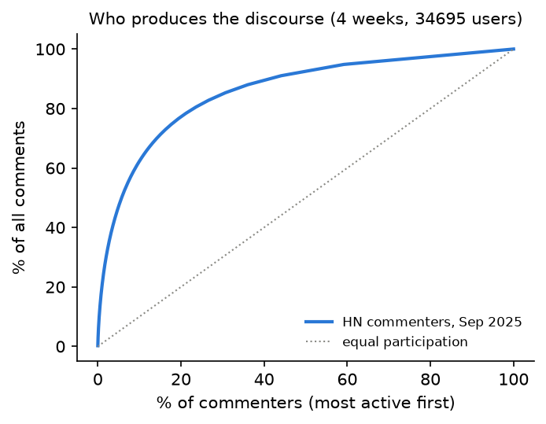
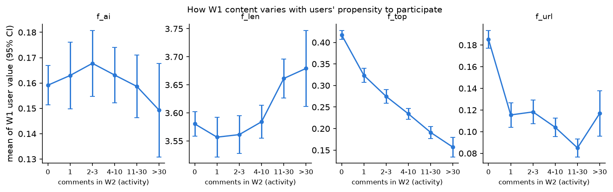
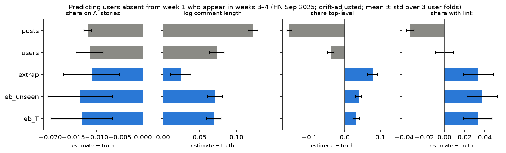

# auto — research report

## 1. Status
00:27 IST — FINAL. Real-data analysis (Hacker News, Sep 2025) complete; no further collection or experiments (deadline 00:36 IST). Review 4 partially addressed (see §6).

## 2. Current best result (real data)
**Data:** 273,574 Hacker News comments posted 2025-09-01 → 2025-09-28 (UTC), 34,695 distinct (hashed) commenters, as returned by the public Algolia HN Search API (complete coverage of the Algolia index for this period, not independently verified against HN itself).

**A. The selection is strong and stable** (`python describe_hn.py` → results/hn_describe.json):
- Each week, the top 1% of commenters write 13.4–14.5% of comments, the top 10% write 50–51%, and 46–49% of commenters post exactly once (4 weeks, stable).
- Propensity is a persistent trait: Spearman 0.57 between a user's week-1 and week-2 counts; 52% of week-1 commenters return in week 2.
- Any one week's discourse sees only part of the active base: week 1 shows 15,906 commenters; a two-week capture-recapture estimate says ~30,600 active users, and 4 weeks actually reveal 34,695 (the two-week estimate is below the four-week count; heterogeneity, new arrivals, departures and dependence between weeks are all possible reasons, and this data can't separate them).

**B. Content depends on propensity** (week-1 comments, users binned by their *independent* week-2 activity; results/hn_gradient.csv):
- Share of top-level comments (replying to the story rather than to another person): **0.42** for users absent next week → **0.16** for users with >30 comments next week. High-propensity users write mostly replies to other comments; low-propensity users write a much larger share of top-level comments (still under half).
- Share with a link: 0.19 → ~0.10. Comment length rises slightly with activity. Share on AI-related stories: flat.

**C. Can week-1 discourse predict the participants it doesn't show?** Pre-registered test: predict the profile of users absent in week 1 who appear in weeks 3–4 (~4.8k per fold; 3 disjoint user folds; `python predict_hn_ebT.py` → results/hn_predict_ebT.csv). **Absolute error, mean ± std over 3 folds. Primary = raw, a true forecast from weeks 1–2 only:**

| method (raw forecast) | AI-story share | log length | top-level share | link share |
|---|---|---|---|---|
| posts (comment-weighted) | 0.043 ± 0.002 | 0.162 ± 0.009 | 0.147 ± 0.006 | 0.030 ± 0.002 |
| users (one vote per user) | 0.043 ± 0.003 | 0.112 ± 0.008 | **0.030 ± 0.003** | **0.007 ± 0.003** |
| extrap (2·users − posts) | 0.044 ± 0.006 | **0.063 ± 0.009** | 0.087 ± 0.009 | 0.038 ± 0.014 |
| eb_unseen (inverse-propensity) | 0.041 ± 0.006 | 0.110 ± 0.007 | 0.048 ± 0.002 | 0.041 ± 0.014 |
| eb_T (post-hoc, target-matched) | 0.042 ± 0.006 | 0.108 ± 0.008 | 0.041 ± 0.002 | 0.037 ± 0.013 |

Noise floors (2 × fold std of `users`): 0.006 / 0.016 / 0.006 / 0.006. These are conditional heuristics: the 3 folds split users within one month and share the same stories, so they don't capture month-to-month variation. The pre-registered full-data user bootstrap was not run.

*Secondary, drift-adjusted (not a pure forecast: it adds the week-1→week-3 change measured on returning users' weeks 3–4 comments):* AI-story share errors fall to 0.011–0.013 for every method with no differences; length extrap 0.024 vs users 0.073; top-level users 0.039 = eb_unseen 0.039 (signed −0.039 vs +0.039: truth lies between them), eb_T 0.032; link users 0.007, corrections 0.033–0.037 (all overshoot).

- **Clear:** counting each user once instead of each comment removes most of the error on top-level share (0.147 → 0.030) and link share (0.030 → 0.007).
- **Mixed:** propensity-based corrections that push further toward low-activity users overshoot on top-level and link share; only `extrap` helps, and only on length.
- **No signal** on AI-story share: topic drift between weeks dominates (0.16 in week 1 vs ~0.10 later).
- **Drift adjustment is not uniformly helpful:** it assumes returning users' week-1→week-3 change also applies to unseen users, which is untested. It lowers AI-share and length errors, but raises `users`' top-level error from 0.030 to 0.039.
- N = 5 estimators × 4 features × 2 (raw/drift-adjusted); `eb_T` was added after seeing results.

**Raw examples** (week 1): users absent next week (top-level share 0.33 by comment): *[top] "Add a new search engine Name: Google No AI URL: …udm=14"*, *[top] "I'll bring up a cool additional option in this space: gaggimate.eu…"*. Users with >30 comments next week (0.15): *[reply] "Yes but it seems like KeyPassXC could just ask for PIN on every auth request…"*, *[reply] "The US uses extradition in countries with treaties and rendition most everywhere else…"*.

**What the code does:** `predict_hn.py` takes one fold's week-1 comments, averages each feature per user, and forms the four estimates (comment-weighted, user-weighted, extrapolated, and user-weighted with weights e^−λ/(1−e^−λ), where λ is a Gamma empirical-Bayes estimate from the user's week-2 count). Truth is the user-weighted feature mean over that fold's users who comment in weeks 3–4 but not week 1. `predict_hn_drift.py`/`predict_hn_ebT.py` add the week-1→week-3 change seen in returning users to every estimate.

## How the participation bias is modelled
1. **Propensity as a per-person rate.** Each person i comments at a stable personal rate λᵢ per week (Poisson). Whether you are *in* the discourse at all depends on λ (seen in a week with prob 1−e^−λ); how much of the discourse is *yours* is proportional to λ. Real data supports the stability part: Spearman 0.57 between weeks, half of commenters return next week.
2. **Two margins of selection.** *Intensive:* reading comments over-weights high-λ people (top 10% write ~50%). *Extensive:* low-λ people are often absent in any given window (one week sees ~half or less of a month's commenters).
3. **Bias = covariance of content with propensity.** If content didn't vary with λ there would be no bias. It does: top-level share falls from 0.42 to 0.16 across activity bins, link share from 0.19 to ~0.10.
4. **Corrections.** One vote per user removes the intensive margin. Inverse-propensity weights, with λ estimated from a separate window and shrunk with an empirical-Bayes Gamma prior, address the extensive margin, as does extrapolation along activity. On real data the first works reliably; the second overshoots on 2 of 4 features.
5. **Unidentified.** People with λ≈0 (lurkers, non-users) never appear, so nothing in discourse data pins down their size or content. The simulation phase showed a parametric fit to the visible part can extrapolate that mass arbitrarily.

## 3. What I have done
1. (Simulation phase, now groundwork only) Built a simulated world and estimators; reviewer caught a degenerate benchmark; fixed; found reweighting helps, a simple extrapolation ties it, and people who never post are unrecoverable.
2. **01:12 pivot to real data** on the human's instruction. Chose HN (Reddit 403 without OAuth; X/Instagram need paid/auth APIs).
3. Collected 4 weeks of comments (API cap of 1000 hits/query handled by splitting busy hours; retries; cache).
4. Descriptive model of the selection (concentration, stability, capture-recapture, content-by-propensity).
5. Pre-registered prediction test → corrections overshoot on 2 of 4 features; topic drift dominated AI-share.
6. Pre-registered drift adjustment → lowers AI-share error for all methods (under an untested transport assumption); raises `users`' top-level error 0.030 → 0.039.
7. Post-hoc target-matched weights (eb_T) → no clear change. This doesn't rule out target mismatch, because the rate model itself (Poisson rates, moment-fitted EB prior, plug-in weights) was never calibrated.

## 4. What I changed and why
- **Pivot (human instruction):** simulated data not acceptable → real HN data. Simulation results are not evidence.
- **Provenance:** public Algolia HN Search API (`hn.algolia.com/api/v1/search_by_date`, tags=comment), hourly slices split when >1000 hits, 4 concurrent requests + 0.25 s pause, generic User-Agent. Usernames SHA-256-hashed (16 hex) on ingest; text stored only locally (auto/data/) for feature extraction. Code: `src/collect_hn.py`.
- Folds (3 disjoint user-hash groups) replace seeds as replicates; there's no randomness to seed.
- Drift adjustment added (pre-registered) after seeing that AI-story share fell from 0.16 (week 1) to ~0.10 (weeks 2–3).
- eb_T added post-hoc and labelled so.

## 5. Figures

Lorenz curve: share of all September comments produced by the most active commenters (dotted = equal participation).

Week-1 content by users' week-2 activity (f_ai AI-story share, f_len log length, f_top top-level share, f_url link share; 95% CIs). Top-level share falls steeply with propensity.

Signed prediction error (drift-adjusted secondary analysis) for users absent from week 1 who appear in weeks 3–4; gray = baselines. Truth on top-level share lies between `users` and the propensity corrections.

## 6. Reviewer feedback
- Review 0: connectivity test.
- Review 1 (simulation): benchmark degenerate (const beat all) → fixed world, reran; prior-forwarding bug fixed; "9× floor" corrected; oracle reworded.
- Review 2 (simulation): ablation overclaimed; simple extrapolation nearly ties → tested on fresh seeds: no clear difference; claims narrowed.
- Review 3 (simulation): wording "ties" → "no clear difference"; flagged identical rates across windows.
- Review 4 (real data; partial output at deadline): (a) table showed mean signed error as if it were error → now absolute error with signed direction in text; (b) drift-adjusted estimates use weeks 3–4 content of returning users, so they aren't pure forecasts → raw forecast is now primary, drift-adjusted labelled secondary. (c) Reviewer's provenance checks: 674 cached slices, no gaps/overlaps over the 4 weeks, max 904 hits per slice (<1000 cap), 0 out-of-slice comments; it flagged "cache/CSV match: False" → I re-checked: after hashing authors identically, the (user, time) multisets of cache and CSV are identical (273,574 rows each). Review 4 was still running at the deadline; any later points are not addressed.

- Review 4 final (PROBLEMS FOUND), all addressed in wording at the deadline: (1) "median participant", "mostly react" and "argue" overclaimed → reworded. (2) Raw cache held plaintext usernames → now hashed in place (273,574 authors); "all HN comments" narrowed to the Algolia index; capture-recapture comparison no longer attributed to heterogeneity alone. (3) Drift adjustment rests on an untested transport assumption → stated. (4) Fold std is a conditional heuristic; bootstrap not run → stated. (5) The Poisson/EB participation model was never calibrated, so eb_T's failure doesn't rule out target mismatch → stated. (6) Drift-adjustment regression on `users` top-level (0.030 → 0.039) → reported. (7) Decisive test = frozen raw pipeline on an untouched later month → listed below, not run.

## 7. What the observations can and cannot establish; caveats
- **Bottom line:** one month of one site supports a *behavioural association* between participation propensity and what people write, plus a reliable gain from counting users instead of comments. It does not yet validate a model of participation bias: the Poisson-rate model was never calibrated, and nothing was tested outside this month.
- **Can:** HN discourse is dominated by a small, persistent high-propensity group; what you read (comment-weighted) differs measurably from what less active participants write (e.g. top-level share 0.22 by comment vs ~0.42 for users absent the next week); one week sees roughly half or less of the active base.
- **Cannot:** anything about people who never comment (lurkers, non-users) — they are absent from this data entirely, so this measures selection *among participants*, not participants vs. the public. The features are behavioural (reply vs top-level, links, length, topic), not opinions; no stance measure was available without a labelled model.
- **Sampling limits:** one site, one month; Algolia index completeness not independently verified (weekly volumes are stable, 4 duplicates in 273k); deleted/flagged comments missing; "users absent in week 1 who appear in weeks 3–4" mixes low-propensity regulars with newcomers and returners — a likely reason propensity-based corrections overshoot.
- **Coverage:** 2025-09-01 → 09-28 UTC only; Hacker News only; 273,574 comments / 34,695 hashed users; no held-out month was collected, so all prediction results are in-sample to this month (the 3 folds split users, not time).
- Cheapest next test: rerun the frozen pipeline on a later, untouched month.
